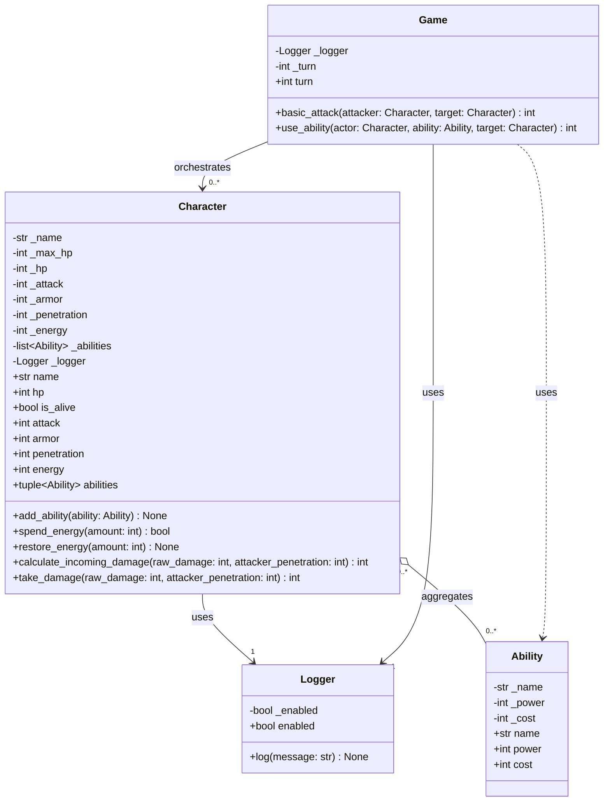

# Практичне заняття 2. Інкапсуляція — UML-діаграма класів



## Ролі класів та взаємодія

- **`Logger`** — інкапсулює вивід повідомлень про події (побічний ефект). Дозволяє вимкнути або змінити спосіб логування без зміни бізнес-логіки `Character` та `Game`.
- **`Ability`** — описує здібність персонажа (`name`, `power`, `cost`) і захищає свої поля від некоректних значень через `@property`.
- **`Character`** — зберігає стан персонажа (`_hp`, `_energy`, `_armor`, `_penetration`, `_attack`) та інкапсулює правила отримання шкоди (`take_damage`, `calculate_incoming_damage`).
- **`Game`** — керує ходом бою (`_turn`), перевіряє можливість атаки або використання здібності, списує енергію та координує взаємодію між персонажами і `Logger`.


----------------------------------------------------------------------------------------------------------------------------------------------------------------


## Практичне заняття 3. Наслідування та поліморфізм

### Пояснення архітектури та вибору структури

Структурований текст за своєю суттю є деревоподібною структурою даних, де елементи поділяються на дві категорії: **контейнери** (можуть містити вкладені елементи) та **кінцеві/листові елементи** (зберігають власний контент без нащадків).

* **Абстракція** задає єдиний контракт `render()` для всіх вузлів і виносить спільну логіку в базові абстрактні класи (`Container`, `Leaf`), щоб не дублювати код.
* **Наслідування** дозволяє спеціалізувати поведінку конкретних елементів (`Root`, `Heading`, `Paragraph`) від спільних предків.
* **Поліморфізм** дозволяє зберігати різні елементи в одній колекції (`list[TextElement]`) і викликати `render()` однаково незалежно від конкретного класу.

### Ролі ключових класів

* **`TextElement`** — абстрактний базовий клас (`ABC`), який визначає спільний інтерфейс усіх елементів структурованого тексту через метод `render() -> str`.
* **`Container`** — абстрактний клас контейнера: зберігає назву (`_name`), посилання на батька (`_parent`) та список дочірніх елементів (`_children`), реалізує додавання нащадків (`add_child`) і перевірку кореня (`is_root`).
* **`Leaf`** — абстрактний клас кінцевого елемента без дочірніх вузлів; зберігає вміст (`_content`) і безпечно приводить `None` до порожнього рядка.
* **`Root`** — кореневий контейнер документа (`parent=None`), виводить заголовок документа (`Title: ...`) і рендерить усіх нащадків.
* **`Heading`** — контейнер заголовка з рангом вкладеності (`rank >= 0`), формує табуляцію для самого заголовка та вкладених елементів.
* **`Paragraph`** — кінцевий текстовий блок, який повертає свій текст у `render()`.
* **`TextFactory`** — інкапсулює створення вузлів (`Root`, `Heading`, `Paragraph`) і навігацію по дереву (`_current`, методи `add_heading`, `add_paragraph`, `up`), спрощуючи побудову документа та майбутнє розширення форматів виводу.

### Діаграма класів

запуск: python -m text_system.main

```mermaid
classDiagram
    class TextElement {
        <<abstract>>
        +render()* str
    }

    class Container {
        <<abstract>>
        -_name : str
        -_parent : Container | None
        -_children : list~TextElement~
        +name() str
        +parent() Container | None
        +children() tuple~TextElement, ...~
        +add_child(child : TextElement) void
        +is_root() bool
        +render()* str
    }

    class Leaf {
        <<abstract>>
        -_content : str
        +content() str
        +render()* str
    }

    class Root {
        +render() str
    }

    class Heading {
        -_rank : int
        +rank() int
        +render() str
    }

    class Paragraph {
        +render() str
    }

    class TextFactory {
        -_root : Root
        -_current : Container
        +add_heading(name : str, rank : int) void
        +add_paragraph(content : str | None) void
        +up() void
        +render() str
        +__str__() str
    }

    TextElement <|-- Container : inherits
    TextElement <|-- Leaf : inherits
    Container <|-- Root : inherits
    Container <|-- Heading : inherits
    Leaf <|-- Paragraph : inherits
    Container o--> TextElement : _children (0..*)
    Container --> Container : _parent (0..1)
    TextFactory *-- Root : owns _root
    TextFactory --> Container : tracks _current
---

## Практичне заняття 4. Практика SOLID

### Архітектура та дотримання принципів SOLID
Для взаємодії з системами `Characters` та `Text` реалізовано динамічний консольний інтерфейс (`cli/`), побудований за принципами SOLID:

- **SRP (Single Responsibility Principle):** парсинг аргументів і опцій винесено в `cli/parser.py` (`CommandParser`), диспетчеризацію та цикл виконання — у `cli/engine.py` (`CommandRegistry`, `CLIApp`), а логіку конкретних команд — в окремі модулі `cli/characters_commands.py` та `cli/text_commands.py`.
- **OCP (Open/Closed Principle):** нові команди додаються через `CommandRegistry.add_command(selector, handler)` без зміни ядра `CLIApp`. У `TextFactory` використано `TextType(Enum)` для розширення типів елементів без зміни інтерфейсу.
- **LSP (Liskov Substitution Principle):** елементи документа (`Root`, `Heading`, `Paragraph`) взаємозамінні через спільний абстрактний контракт `TextElement.render(show_id=...)`.
- **ISP (Interface Segregation Principle):** інтерфейси команд розділені за режимами (`--text` та `--chars`), кожна підсистема реєструє лише свої команди.
- **DIP (Dependency Inversion Principle):** `CLIApp` залежить від абстрактного реєстру обробників (`CommandHandler`), а не від конкретних класів `Game` чи `TextFactory`.

### Запуск CLI
```bash
python main.py --text   # режим роботи з системою Text
python main.py --chars  # режим роботи з системою Characters
python main.py          # інтерактивний вибір режиму
```

### Підтримувані команди
Characters: create <char|item|ability>, add --char_id <id/name> --id <id/name>, act <attack|heal|ability> <actor> <target> [--id <id/name>], ls <char|item|ability> [--id <id/name>], help, exit.

Text: pwd, print [--whole] [--id], add <container|leaf> <type>, rm [<elem_name>], up, cd <path> | --id <container_id>, help, exit.
