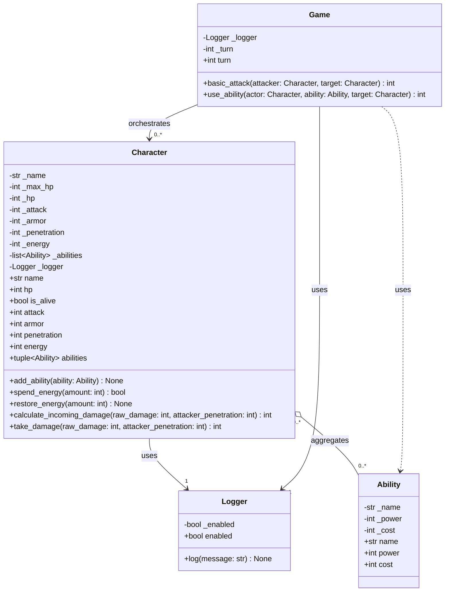

# Практичне заняття 2. Інкапсуляція — UML-діаграма класів

## Ролі класів та взаємодія

- **`Logger`** — інкапсулює вивід повідомлень про події (побічний ефект). Дозволяє вимкнути або змінити спосіб логування без зміни бізнес-логіки `Character` та `Game`.
- **`Ability`** — описує здібність персонажа (`name`, `power`, `cost`) і захищає свої поля від некоректних значень через `@property`.
- **`Character`** — зберігає стан персонажа (`_hp`, `_energy`, `_armor`, `_penetration`, `_attack`) та інкапсулює правила отримання шкоди (`take_damage`, `calculate_incoming_damage`).
- **`Game`** — керує ходом бою (`_turn`), перевіряє можливість атаки або використання здібності, списує енергію та координує взаємодію між персонажами і `Logger`.
