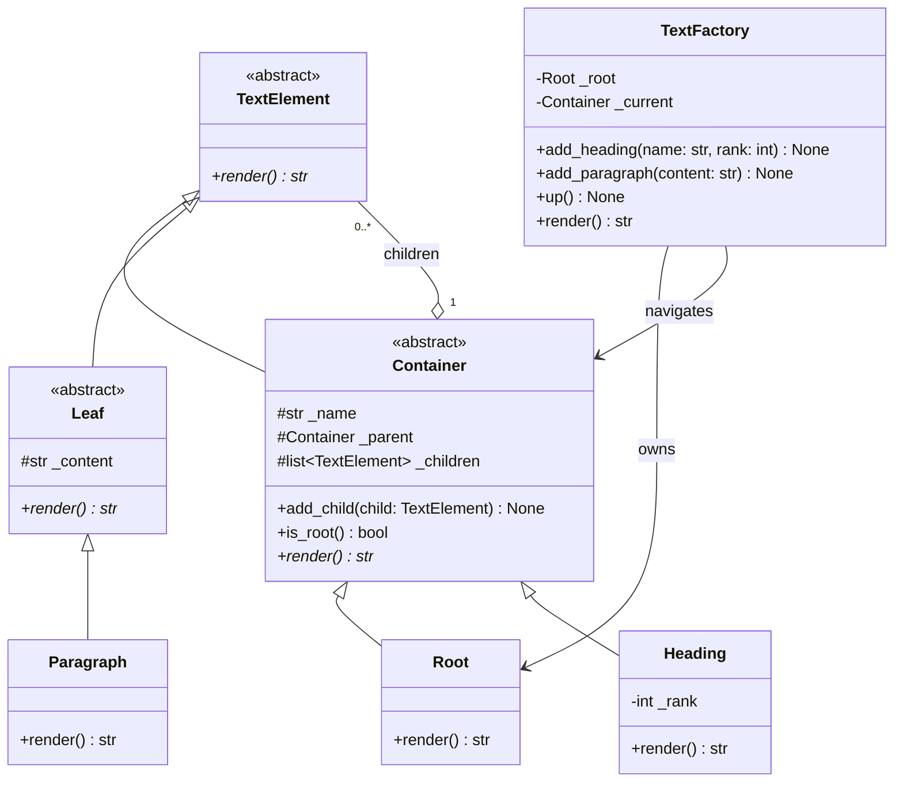

### Чому обрана саме така структура та ролі ключових класів
- **Чому така ієрархія:** Структурований текст за своєю природою є деревом (патерн *Composite*), де є вузли з вкладеними елементами та кінцеві елементи без дітей[cite: 14, 15, 16]. Поділ на `Container` і `Leaf` від єдиного абстрактного контракту `TextElement` дозволяє викликати `render()` поліморфно для будь-якого елемента й легко додавати нові формати виводу в майбутньому[cite: 14, 15].
- **`TextElement`** — абстрактний базовий тип, який задає єдиний контракт `render()` для всіх елементів документа.
- **`Container`** — абстрактний клас для вузлів-контейнерів (`_children`, `_parent`, `add_child()`, `is_root()`), щоб не дублювати логіку зберігання дочірніх елементів.
- **`Leaf`** — абстрактний клас для кінцевих елементів (`_content`), які містять текст без вкладених вузлів.
- **`Root` та `Heading`** — конкретні контейнери: `Root` представляє корінь документа, а `Heading` додає рівень вкладеності (`_rank`) і відступи при рендері.
- **`Paragraph`** — конкретний кінцевий елемент для рендеру абзаців.
- **`TextFactory`** — інкапсулює створення вузлів і навігацію по дереву (`add_heading`, `add_paragraph`, `up`), надаючи клієнтському коду єдиний зручний інтерфейс[cite: 20, 21].
